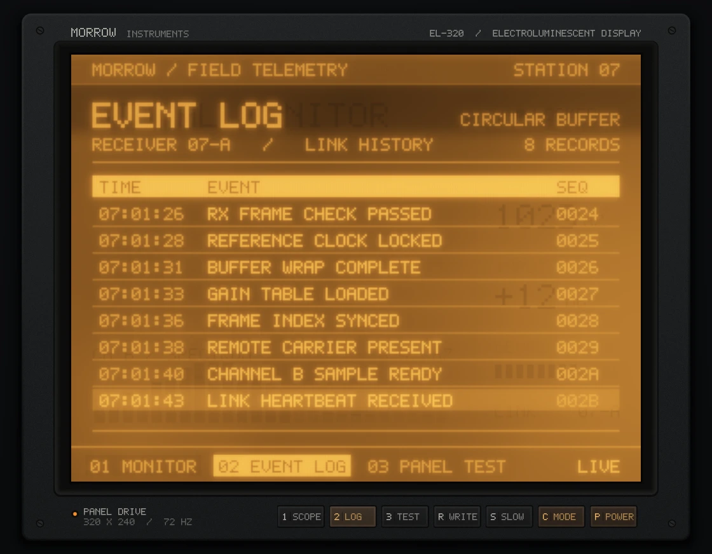
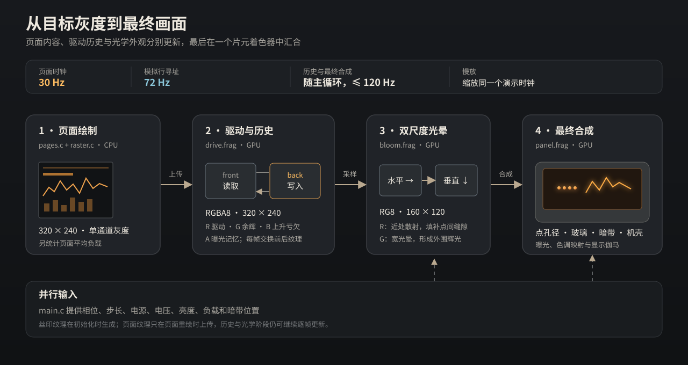
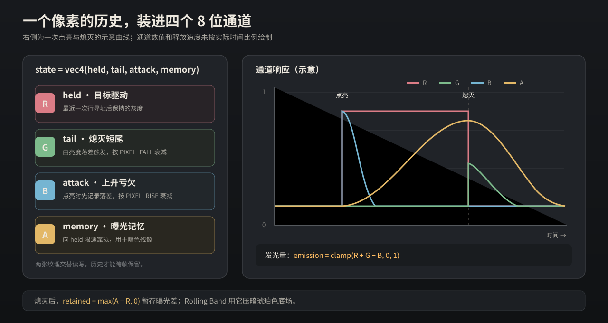
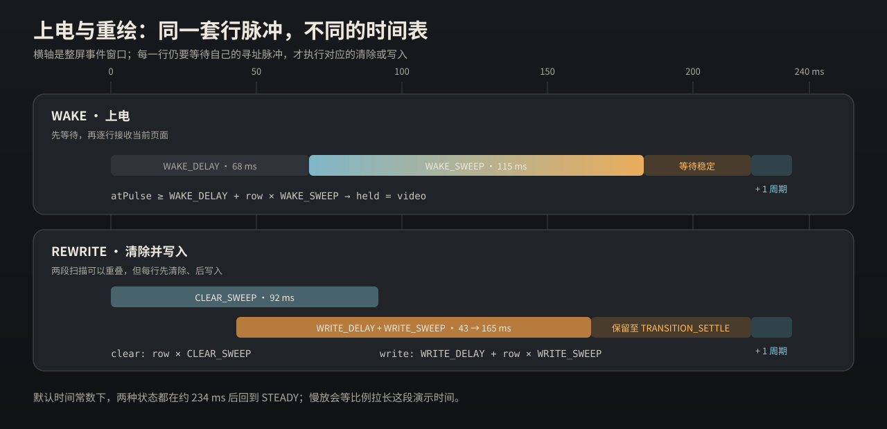

# Morrow EL-320

用 C、SDL3 和 OpenGL ES 3.0 渲染的 320×240 琥珀色薄膜电致发光屏幕（TFEL）。演示内容包括实时示波器、逐字写入的事件日志和点阵测试图，也可以观察上电、清屏和逐行写入时的瞬态变化。

An amber electroluminescent display demo with a native 320×240 dot matrix, row-by-row redraws, optical bloom, and an alternate filmed look with a drifting band and a short dark afterimage.

## 效果预览

| Soft Glow | Rolling Band |
| :---: | :---: |
|  |  |

### 演示视频

https://github.com/user-attachments/assets/818261cc-0c06-481b-a25c-d37c01abc466

视频先展示深色底的 Soft Glow，再点击 `C MODE` 切到琥珀底色的 Rolling Band。两种模式都用柔和的光晕让相邻亮点连成笔画。切到日志页后，旧字形和曲线会在底色上留下暗影，约三秒内淡去。

[下载 MP4](media/demo.mp4?raw=1)

## 构建和运行

需要 C11 编译器、CMake 3.16+、pkg-config、SDL3 开发文件和支持 OpenGL ES 3.0 的驱动。构建在 Linux 上验证过，Mesa 软件渲染也可以运行。点阵字体、界面和着色器均编入可执行文件。

```sh
cmake -S . -B build -DCMAKE_BUILD_TYPE=Release
cmake --build build
./build/el-screen
```

## 操作

| 键 | 操作 |
| --- | --- |
| `1` / `2` / `3` | 切换示波器、事件日志、面板测试 |
| `Tab` / `Shift+Tab` | 向前 / 向后循环切页 |
| `R` | 清除并逐行重绘当前页 |
| `S` | 慢放至 15% |
| `C` | 切换 Soft Glow 和 Rolling Band |
| `P` | 开关面板电源 |
| `B` | 开关加强光晕 |
| `Space` | 暂停页面内容 |
| `-` / `+` | 调低 / 调高亮度 |
| `V` / `F` | 仅显示面板 / 全屏 |
| `Esc` | 退出 |

屏内页签和机壳按钮都可以点击。想观察画面分行替换，可以先按 `S`，再按 `R` 或切页。暂停页面内容时，暗带仍会移动。

## 渲染与调参

### 关键文件

| 文件 | 职责 |
| --- | --- |
| [`src/main.c`](src/main.c) | 处理输入，推进页面、行扫描、电源和暗带的时钟，计算电压与负载，并触发每一次渲染。 |
| [`src/pages.c`](src/pages.c) / [`src/pages.h`](src/pages.h) | 绘制示波器、事件日志和测试页，计算机壳丝印；同时统计页面平均灰度，作为电气负载的输入。 |
| [`src/raster.c`](src/raster.c) / [`src/raster.h`](src/raster.h) | 提供像素、矩形、直线和 5×7 点阵字体等基础绘图操作。 |
| [`src/display.c`](src/display.c) / [`src/display.h`](src/display.h) | 创建纹理、帧缓冲和着色器程序，设置高斯权重，依次执行驱动、光晕和最终合成三个渲染阶段。 |
| [`src/tuning.h`](src/tuning.h) | 集中保存尺寸、频率、时间常数、颜色和光晕参数，同时供 C 与 GLSL 使用。 |
| [`shaders/drive.frag`](shaders/drive.frag) | 模拟逐行寻址，在两张历史纹理之间交替更新驱动值、亮度响应和曝光记忆。 |
| [`shaders/bloom.frag`](shaders/bloom.frag) | 在半分辨率下执行可分离高斯滤波，一次得到近处散射和宽光晕两组结果。 |
| [`shaders/panel.frag`](shaders/panel.frag) | 绘制发光点、玻璃、暗带、残像和机壳，完成色调映射并输出窗口画面。 |
| [`shaders/fullscreen.vert`](shaders/fullscreen.vert) | 用 `gl_VertexID` 生成覆盖渲染目标的单个三角形，不需要顶点缓冲区。 |
| [`CMakeLists.txt`](CMakeLists.txt) | 把调参头和着色器嵌入可执行文件，并在它们变化时触发重新配置。 |

### 从一张灰度图到一块琥珀色屏幕

我们可以把整个实现理解为一条分工明确的流水线：CPU 绘制“这一刻应该显示什么”，驱动着色器计算“每个点此刻实际发出多少光”，最后的合成着色器再决定“这些光透过玻璃后看起来怎样”。页面内容、驱动历史与光学外观因此可以分别调整，不必把所有效果堆进页面绘制代码。



#### 页面先只是 320×240 的灰度数据

`draw_page()` 每画一帧都会清空灰度缓冲区，再绘制公共页框和当前页面。示波器曲线由短直线连接，日志逐字出现，测试页则直接改变点阵图案。这里的灰度值只是目标电平：`0` 表示不点亮，`255` 表示全亮，中间值用于网格、标签和较暗的界面元素。它还不是最终亮度，因为行寻址、余辉、光晕和电压变化都尚未参与计算。

`raster.c` 中的字体也是真正的点阵字体。每个字形用 5×7 个位表示，绘图时把置位的像素写成小矩形。这让文字与曲线共享同一套低分辨率栅格规则，而不是先绘制平滑字体、再故意缩小制造颗粒感。

页面绘制完成后，`pages.c` 会把所有像素的灰度相加并归一化，得到一个平均负载。`main.c` 再用 `LOAD_RESPONSE` 对它做指数平滑，最终由 `panel.frag` 通过 `LOAD_SAG` 轻微压低整屏亮度。因此，大面积点亮的测试页与小面积点亮的文字页可以有不同的亮度表现，而我们不需要为每个页面手工指定负载。

#### 30 Hz、72 Hz 和窗口帧率各管一件事

这条链路里有三种容易混淆的更新频率。页面内容默认以 `VIDEO_HZ = 30` Hz 重绘，切页和暂停等操作会额外标记脏帧，使下一次主循环立即上传；`PANEL_HZ = 72` Hz 是模拟行寻址的频率；`display_render()` 则随主循环执行，由垂直同步和 `MAX_RENDER_HZ = 120` 共同限制上限。也就是说，窗口可以重绘多次，而页面灰度图仍保持原样，历史纹理却会继续衰减，暗带也会继续移动。

驱动着色器没有为每一行启动一次绘制，而是在一次全屏 pass 中为每个像素恢复最近一次行脉冲。核心表达式是：

```glsl
float sincePulse = fract(uPhase - row) * uPeriod;
bool addressed = sincePulse < uStep;
```

`uPhase` 是当前 72 Hz 周期内的位置，`row` 是像素所在行，`sincePulse` 则把行位置换算成“距离本行上一次被寻址过去了多久”。只有在这段时间落在当前渲染步长内时，该行才接收新的灰度值；其余像素保持原状态。即使一个渲染帧跨过多个面板周期，这个取模计算仍能找到最近一次脉冲，不要求主循环严格以 72 Hz 运行。

主循环还把单帧时间截断到 `MAX_FRAME_STEP = 0.10` 秒，避免窗口拖动或系统停顿后一次推进过长时间。按 `S` 后，`SLOW_RATE` 会缩放整个演示时钟，所以页面、扫描、瞬态和暗带一起变慢，而不只是降低窗口帧率。

#### 一张 RGBA8 纹理保存四种历史

驱动阶段的输出不是颜色，而是一份逐像素状态。`display.c` 准备两张 320×240 的 `GL_RGBA8` 纹理：从 `light[front]` 读取上一帧，写入 `light[back]`，随后交换前后索引。这样既能连续积累历史，也不会在同一个 pass 中读写同一张纹理。



四个通道分别承担不同任务：

| 通道 | 内容 | 后续用途 |
| --- | --- | --- |
| `R` | 最近一次行寻址后保持的目标驱动值 `held` | 点的基本亮度，以及曝光记忆的追踪目标 |
| `G` | 熄灭后的短余辉 `tail` | 补足刚熄灭时的亮度 |
| `B` | 点亮后尚未消失的上升亏欠 `attack` | 让新点亮的点不会立即到达目标亮度 |
| `A` | 限速积累、缓慢释放的曝光记忆 `memory` | Rolling Band 模式的暗色残像 |

最终用于发光计算的表达式很紧凑：`emission = clamp(R + G - B, 0, 1)`。点亮时，`B` 先记录新旧驱动值之差，再按 `PIXEL_RISE` 衰减；熄灭时，`G` 根据落差和 `PIXEL_TAIL_GAIN` 获得短尾，再按 `PIXEL_FALL` 衰减。两种响应都使用指数形式，但我们看到的时间常数仍以这些参数为准，而不是显示器实际刷新率。

这里选择 `RGBA8` 也意味着每个通道只有 256 个码值。`HISTORY_DECAY_BIAS_CODES` 给衰减减去略多于半个码值的偏置，防止浮点结果量化回 8 位后留下永远不为零的尾数。`A` 通道的步进更特殊：`main.c` 用绝对演示时间和 `floor()` 计算应跨越多少个完整码值，再把步数交给着色器。这样，即使单帧增量小于一个码值，曝光记忆也不会因为反复四舍五入而停住。

#### 上电和重绘都是逐行发生的过程

行寻址还承载了页面切换的瞬态。`main.c` 只维护 `STEADY`、`WAKE` 和 `REWRITE` 三种状态及状态年龄，具体哪一行何时清除、何时写入，仍由 `drive.frag` 根据该行最近脉冲发生时的 `atPulse` 判断。



上电时，每行要等 `WAKE_DELAY + row * WAKE_SWEEP` 后才接收页面数据，因此点亮过程沿行方向展开。重绘则分成清除和写入两段：第 `row` 行先在 `row * CLEAR_SWEEP` 后变暗，再在 `WRITE_DELAY + row * WRITE_SWEEP` 后接收新页。两段扫过屏幕的时间可以重叠，但每一行都有自己的先后顺序。状态还会保留到 `TRANSITION_SETTLE` 并多等一个面板周期，随后才回到稳定驱动。

因为我们按 `S` 缩放的是同一个演示时钟，所以慢放会直接改变这些事件的视觉速度，而不需要修改 `WAKE_SWEEP` 或 `WRITE_SWEEP`。想观察单行变化时，按 `S` 后按 `R`，比单纯截图更容易看清这一过程。

#### 光晕用两次绘制得到两种尺度

`bloom.frag` 的两个输出通道对应不同的高斯核：`R` 使用 `BLOOM_NEAR_SIGMA`，负责填补相邻发光点之间的缝隙；`G` 使用 `BLOOM_WIDE_SIGMA`，负责较宽的外围光晕。`display.c` 在初始化时计算并归一化两组权重，着色器不需要逐像素重复计算指数。

滤波在半分辨率的 160×120 目标上完成。第一遍沿水平方向采样当前发光状态，同时把亮度和一个随亮度非线性增长的值写入两个通道；第二遍沿垂直方向处理这两个通道。每遍以中心样本加两侧各 `BLOOM_RADIUS` 个样本组成一维核，两次绘制合起来得到二维可分离滤波。近、宽两种尺度共用同一趟采样，只是在每个样本上使用不同权重。

按 `B` 可以比较开关光晕的画面。不过这个开关也会切换 `BASE_EXPOSURE` / `BLOOM_EXPOSURE`、两组琥珀色以及 soften 混合分支，因此它比较的是两套完整观感，而不只是给同一张图加或去掉模糊。

#### 最终合成把亮度重新拆成一个个发光点

到了 `panel.frag`，我们先根据窗口尺寸计算机壳或玻璃区域的等比缩放，再把窗口坐标映射回设计坐标。玻璃内的每个输出像素都会映射到 320×240 点阵中的一个位置。

发光点不是简单放大的方形 texel。着色器用 `DOT_HALF_WIDTH` 和 `DOT_HALF_HEIGHT` 定义略小于点距的矩形孔径，再把输出像素的覆盖区域与孔径求交。覆盖区域跨过点之间的间隙时，还会累计水平、垂直和对角相邻点的贡献。这样，缩放到不同窗口尺寸时，点亮面积和电极间隙仍能保持一致的几何意义；在很低的分辨率下，则逐渐退回插值结果，避免孔径积分难以稳定采样。

每个点的亮度还叠加确定性的点、列、行扰动，避免整片点阵完全一致。四邻域采样模拟盖玻璃中的小范围散射，行扫描年龄和极性则引入很轻的脉冲纹波。之后，代码统一施加用户亮度、电源电压和负载压降，再按通道计算 `1 - exp(-exposure * light * amber)`，最后做 `DISPLAY_GAMMA` 对应的显示变换。光晕在这套色调映射之前加入，所以它与本点亮度共享同一套曝光响应。

玻璃外的机壳也由同一个片元着色器绘制。圆角距离场构成外壳、边框、密封圈和螺钉，位掩码控制按钮的按下状态，`silkscreen` 纹理提供由同一套点阵字体生成的铭牌和按钮文字。按 `V` 时只是改用玻璃区域做等比适配，内部渲染链路并不改变。

#### Rolling Band 的暗带与暗色残像来自两份数据

按 `C` 切到 Rolling Band 后，画面会增加一个不均匀的琥珀色底场。`amberIdleField()` 把基础亮度、几处较宽的空间明暗和两种尺度的噪声叠加起来，因此即使页面没有点亮任何像素，玻璃也不是纯黑。

暗带的位置由 `BAND_PERIOD`、`BAND_START` 和 `BAND_TRAVEL` 决定，半宽则由 `BAND_WIDTH`、`BAND_WIDTH_SWING` 和 `BAND_WIDTH_RATE` 缓慢调制。它按演示时间向上移动，并在玻璃外完成回绕；`BAND_DEPTH` 同时压暗本点发光和琥珀色底场，所以暗带不会只影响其中一层。

暗色残像使用历史纹理的 `A` 通道。点熄灭后，`R` 很快归零，而 `A` 只能按 `MEMORY_RELEASE` 限速下降，于是 `retained = max(A - R, 0)` 暂时保留一块“这里曾经很亮”的记录。合成时，代码用 `retained * (RESIDUAL_SOFT + RESIDUAL_DARK * retained)` 压暗琥珀色底场。它模拟的是曝光差异形成的暗影，而不是给已熄灭的像素再添加负光；重新点亮后 `R` 回到高位，这项抑制也会自然消失。`MEMORY_CHARGE` 和 `MEMORY_RELEASE` 分别控制积累与释放走完整个灰度范围所需的时间，实际可见时长还取决于原来的亮度差。

### 参数放在哪里，怎样调

常用参数集中在 [`src/tuning.h`](src/tuning.h)，可以分为以下几组：

| 想调整的部分 | 主要参数 | 调整时会改变什么 |
| --- | --- | --- |
| 点阵与机壳尺寸 | `PANEL_W/H`、`CASE_W/H`、`GLASS_W/H`、`INK_SCALE` | 点阵分辨率、玻璃和外壳的设计尺寸、丝印精度 |
| 更新与慢放 | `PANEL_HZ`、`VIDEO_HZ`、`MAX_RENDER_HZ`、`SLOW_RATE` | 页面更新、行寻址、渲染上限和慢放比例 |
| 上电与重绘 | `WAKE_*`、`CLEAR_SWEEP`、`WRITE_*`、`TRANSITION_SETTLE` | 清除和写入的起始延迟、扫屏速度、瞬态保留时间 |
| 点亮与熄灭 | `PIXEL_RISE`、`PIXEL_FALL`、`PIXEL_TAIL_GAIN` | 上升响应、短余辉长度和余辉强度 |
| 曝光记忆 | `MEMORY_CHARGE`、`MEMORY_RELEASE`、`RESIDUAL_SOFT`、`RESIDUAL_DARK` | 残像形成、消退速度，以及线性和二次压暗强度 |
| 发光点与玻璃 | `DOT_*`、`GLASS_SCATTER_*`、`LOAD_SAG`、`PULSE_RIPPLE` | 点形、颗粒差异、近邻散射、负载压降和扫描纹波 |
| 曝光与光晕 | `BASE_EXPOSURE`、`BLOOM_EXPOSURE`、`BLOOM_*_SIGMA`、`DARK_FIELD_BLOOM_*`、`ROLLING_FIELD_BLOOM_*` | 色调映射、近处填隙和宽光晕在两种模式下的强度 |
| 暗带与底场 | `BAND_*`、`IDLE_*` | 暗带周期、宽度、深度，以及琥珀底色的空间分布和颗粒变化 |

这些宏先由 C 源码直接包含，也由 CMake 插入每个 GLSL 文件的 `#version` 之后。构建目录中的 `shaders/` 和 `shader_sources.h` 是生成结果；我们应编辑源目录里的参数和着色器，而不是修改生成文件。CMake 已把参数头与着色器列为配置依赖，所以通常只需：

```sh
cmake --build build
```

调光晕时，可以先固定页面和亮度，分别调整 `BLOOM_NEAR_SIGMA` 与对应模式的 `*_BLOOM_NEAR`，再处理宽光晕。前者更容易改变笔画是否连成一片，后者更容易改变整团光的外扩范围。调 Rolling Band 时，可以先暂时把 `BAND_DEPTH` 设为 `0`，确认 `IDLE_*` 底场和残像，再恢复暗带；这样较容易分辨“底色被残像压暗”和“整条暗带扫过”两种效果。调瞬态则适合配合 `S`、`R` 和 `P`，分别观察重绘与上电。

有两条边界值得保留。页面构图使用 320×240 下的固定坐标，单独增大 `PANEL_W/H` 并不会自动重排界面；这里的时序与光学参数也是按实拍观感选取的视觉模型，并非对 TFEL 驱动电路和材料特性的完整物理仿真。调参时以实际画面为准，通常比追求某组参数的“物理正确”更直接。

## 参考

- [琥珀底色、暗带和暗色残像实拍，00:51–00:53](https://www.bilibili.com/video/BV1b3vvBvEbn?t=51)
- [深色背景与强光晕实拍](https://www.bilibili.com/video/BV17h411Q7JZ)
- [GRiD Compass II 实机资料](https://ub.fnwi.uva.nl/computermuseum/gridcompass.html) · [Supertex TFEL 驱动说明](https://ww1.microchip.com/downloads/en/Appnotes/AN-H03.pdf)

亮度与时序参数按实拍观感选取。仓库中的效果图片和视频均为 Demo 自身的录屏，渲染说明图按代码实现绘制。

## 许可

[BSD Zero Clause License（0BSD）](LICENSE)
