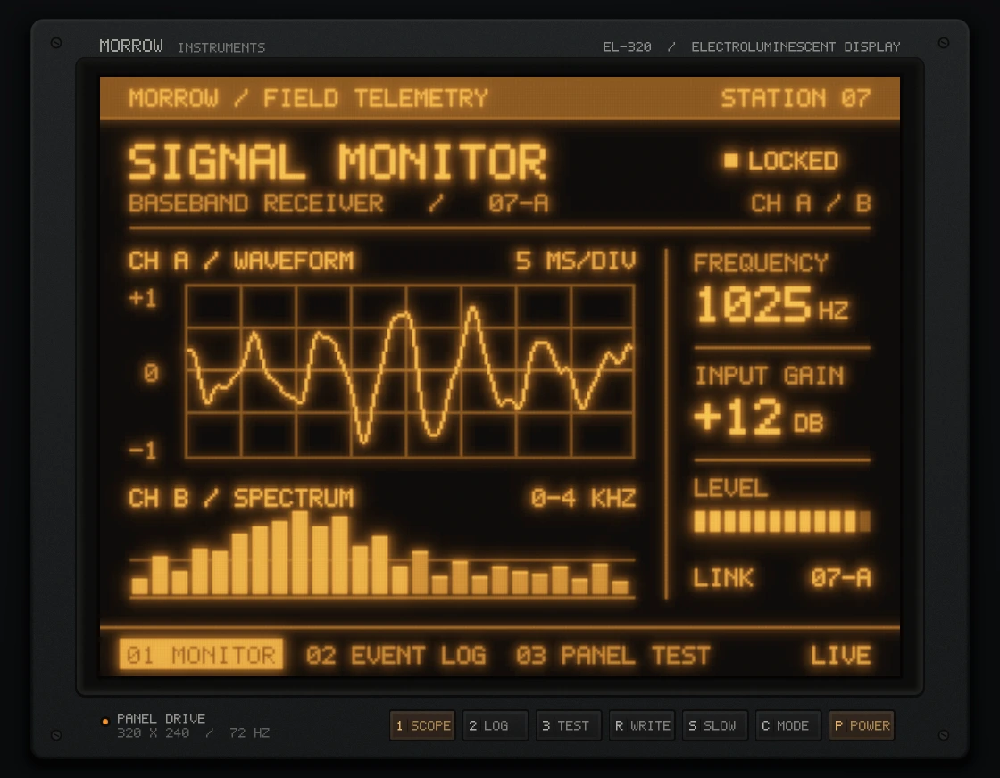

# Morrow EL-320

用 C、SDL3 和 OpenGL ES 3.0 渲染的 320×240 琥珀色薄膜电致发光屏幕（TFEL）。演示内容包括实时示波器、逐字写入的事件日志和点阵测试图，也可以观察上电、清屏和逐行写入时的瞬态变化。

An amber electroluminescent display demo with a native 320×240 dot matrix, row-by-row redraws, optical bloom, and an alternate filmed look with a drifting band and a short dark afterimage.



**[观看演示视频（MP4）](media/demo.mp4?raw=1)** · [查看暗带模式截图](media/rolling.webp)

视频先展示默认柔光模式，再点击 `C MODE` 切换到琥珀底色。在暗带模式下切到日志页，能看到原来亮着的字形和曲线在底色上留下暗影，约三秒内淡去。

## 构建和运行

需要 C11 编译器、CMake 3.16+、pkg-config、SDL3 开发文件和支持 OpenGL ES 3.0 的驱动。构建在 Linux 上验证过，Mesa 软件渲染也可以运行。点阵字体、界面和着色器均编入可执行文件。

```sh
cmake -S . -B build -DCMAKE_BUILD_TYPE=Release
cmake --build build
./build/el-screen
```

## 操作

| 键 | 操作 |
| --- | --- |
| `1` / `2` / `3` | 切换示波器、事件日志、面板测试 |
| `Tab` / `Shift+Tab` | 向前 / 向后循环切页 |
| `R` | 清除并逐行重绘当前页 |
| `S` | 慢放至 15% |
| `C` | 切换柔光模式和琥珀底色的暗带模式 |
| `P` | 开关面板电源 |
| `B` | 开关加强光晕 |
| `Space` | 暂停页面内容 |
| `-` / `+` | 调低 / 调高亮度 |
| `V` / `F` | 仅显示面板 / 全屏 |
| `Esc` | 退出 |

屏内页签和机壳按钮都可以点击。想观察画面分行替换，可以先按 `S`，再按 `R` 或切页。暂停页面内容时，暗带仍会移动。

## 渲染与调参

1. [`src/pages.c`](src/pages.c) 在 320×240 灰度缓冲区绘制界面。
2. [`shaders/drive.frag`](shaders/drive.frag) 按 72 Hz 的模拟行寻址更新两张交替使用的历史纹理，保存驱动值、短余辉和近期曝光。
3. [`shaders/bloom.frag`](shaders/bloom.frag) 分两遍计算近处散射与较宽的光晕。[`shaders/panel.frag`](shaders/panel.frag) 合成矩形发光点、玻璃散射和机壳，并在暗带模式中根据曝光历史压暗刚熄灭的点。

常用参数集中在 [`src/tuning.h`](src/tuning.h)。CMake 在构建时将同一份参数注入 GLSL。可以从 `BLOOM_NEAR_SIGMA`、`BLOOM_WIDE_SIGMA` 调整光晕，从 `BAND_PERIOD`、`BAND_DEPTH` 调整暗带，从 `MEMORY_RELEASE`、`RESIDUAL_DARK` 调整暗色残像。编辑后重新构建即可。页面构图按 320×240 排版。

## 参考

- [琥珀底色、暗带和暗色残像实拍，00:51–00:53](https://www.bilibili.com/video/BV1b3vvBvEbn?t=51)
- [深色背景与强光晕实拍](https://www.bilibili.com/video/BV17h411Q7JZ)
- [GRiD Compass II 实机资料](https://ub.fnwi.uva.nl/computermuseum/gridcompass.html) · [Supertex TFEL 驱动说明](https://ww1.microchip.com/downloads/en/Appnotes/AN-H03.pdf)

亮度与时序参数按实拍观感选取。仓库图片和视频均为 Demo 自身的录屏。

## 许可

[BSD Zero Clause License（0BSD）](LICENSE)
